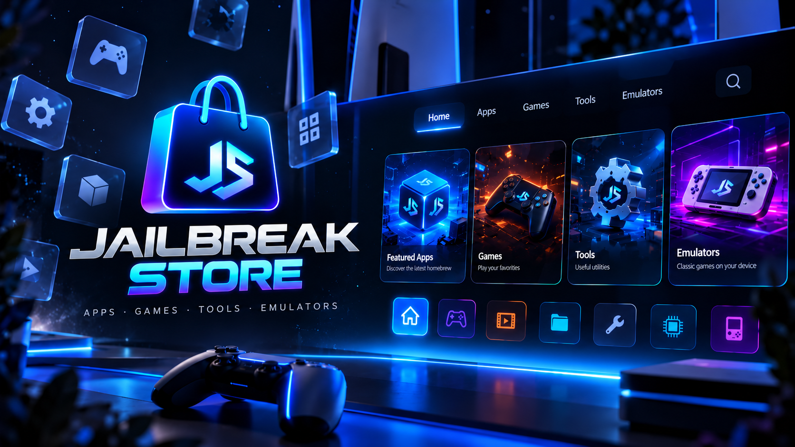
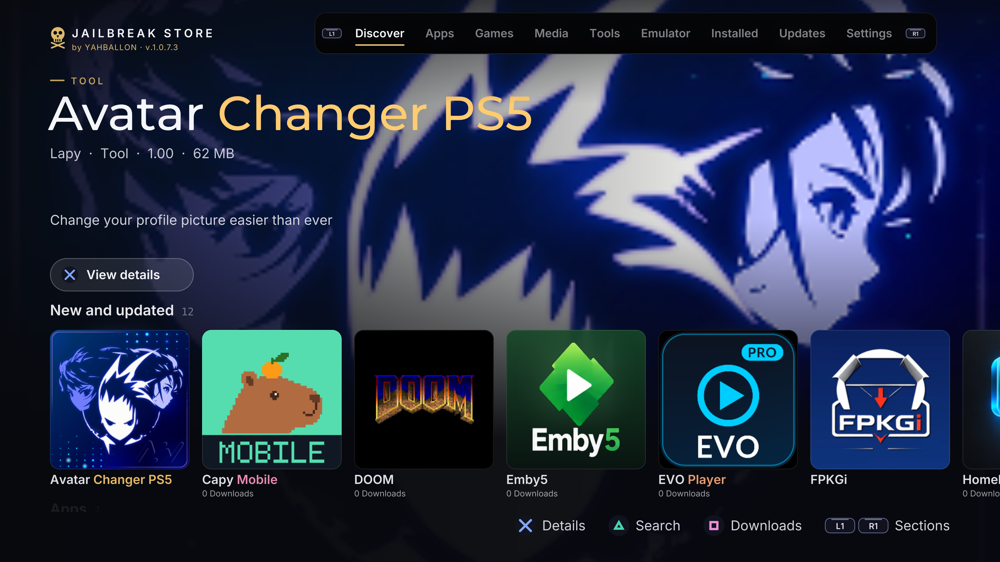
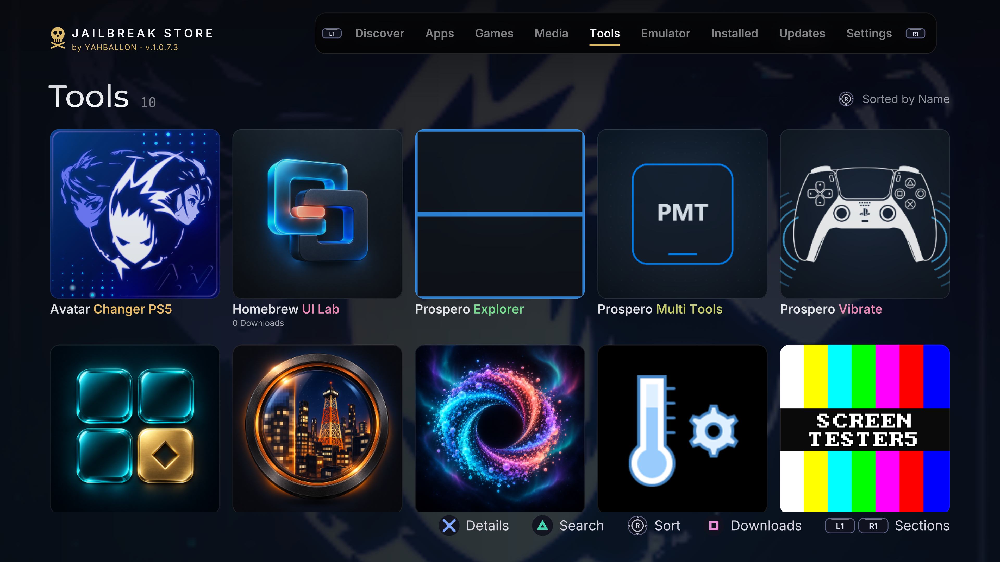

<p align="center">

# JB_STORE

### PS5 Homebrew Store

**Browse, download and install open-source PlayStation 5 homebrew directly from your PS5.**

</p>

<p align="center">
  
</p>

---

JB_STORE is an open-source **PlayStation 5 homebrew store application** designed for compatible jailbroken / homebrew-enabled PS5 systems.

The application reads its software catalog from the separate **JB_STORE_REPO** repository and presents available PS5 homebrew applications in a simple controller-friendly interface.

**JB_STORE is for homebrew — not piracy.**

---

## Repository

The application catalog is maintained separately in:

**https://github.com/Yahballon/JB_STORE_REPO**

JB_STORE reads the application metadata provided by JB_STORE_REPO and uses it to display available homebrew applications and their download information.

This keeps the **store application** and the **software catalog** separate.

### JB_STORE

Contains the PS5 store application itself.

### JB_STORE_REPO

Contains the homebrew repository/catalog data used by JB_STORE.

---

## How it works

JB_STORE downloads the current application catalog from **JB_STORE_REPO**.

Each store entry can contain metadata such as:

```json
{
  "name": "Example Homebrew",
  "type": "app",
  "cover_image": "https://example.com/icon.png",
  "description": "Example open-source PS5 homebrew application.",
  "size_bytes": 12345678,
  "download_url": "https://github.com/example/project/releases/download/1.0/app.zip",
  "title_id": "PPSA00000",
  "version": "1.0.0",
  "format": "zip",
  "status": "available",
  "supported_by_store": true,
  "source_page": "https://github.com/example/project",
  "sha256": "0123456789abcdef...",
  "author": "Example Developer"
}
```

JB_STORE can use this information to:

- Display the application name.
- Display the application icon or cover.
- Show the description.
- Show the author.
- Show the current version.
- Show the download size.
- Download the release archive.
- Verify downloads using SHA-256 when a checksum is available.
- Identify the application's PS5 Title ID.
- Link back to the original project or source page.

The software itself remains hosted by its respective developer or approved distribution source.

---

## Features

- Native PS5 homebrew store interface.
- Controller-friendly navigation.
- Remote homebrew catalog.
- Separate repository architecture.
- Application icons and cover artwork.
- Application descriptions.
- Version information.
- Author information.
- Download size information.
- Direct homebrew downloads.
- SHA-256 download verification when provided.
- Support for ZIP-based PS5 homebrew packages.
- Easy repository updates without rebuilding the complete store application.
- Focus on open-source PS5 homebrew.
- No commercial games included.
- No copyrighted game packages included.

---

## Store architecture

The project is split into two main components:

```text
JB_STORE
│
│   PS5 homebrew store application
│
└── reads
       │
       ▼
JB_STORE_REPO
│
│   Homebrew metadata / catalog
│
├── App 1.json
├── App 2.json
├── App 3.json
└── ...
       │
       ▼
Official / approved project downloads
```

This architecture allows the application catalog to be updated independently from the JB_STORE executable.

A new homebrew application can therefore be added to **JB_STORE_REPO** without requiring a completely new JB_STORE build.

---

## Homebrew catalog

JB_STORE is intended primarily for:

- Open-source PS5 applications.
- Open-source PS5 homebrew games.
- Emulators.
- File managers.
- Media applications.
- Development tools.
- Debugging utilities.
- Network tools.
- Homebrew launchers.
- Open-source ports.
- Experimental PS5 projects.
- Community-created utilities.

Applications should preferably link back to their original source repository.

Whenever possible, downloads should come directly from the original developer's GitHub Releases or another official distribution location.

---

## Installation

JB_STORE requires a PS5 capable of running compatible homebrew applications.

A normal unmodified retail PS5 cannot run JB_STORE.

Download the latest JB_STORE release and install/copy it using the method supported by your PS5 homebrew environment.

After starting JB_STORE, the application retrieves its available homebrew catalog from:

**https://github.com/Yahballon/JB_STORE_REPO**

An internet connection is required to retrieve repository updates and download homebrew applications.

---

## Updates

### Store application updates

Updates to the actual JB_STORE application are published through the JB_STORE project.

### Repository updates

Homebrew applications, versions, icons, hashes and download URLs can be updated independently through:

**JB_STORE_REPO**

This means the catalog can receive updates without requiring a new version of the store itself.

---

## Download verification

JB_STORE repository entries may contain a SHA-256 checksum.

Example:

```text
sha256:f1226e8db42b37cab75b4d6ec10854f85961611c238af27072e3f6961861a54e
```

When supported by the application, this checksum can be used to verify that the downloaded file matches the file listed by the repository.

A failed checksum should be treated as a failed or potentially corrupted download.

---

# Content policy

## Homebrew only

JB_STORE and JB_STORE_REPO are intended for legitimate PS5 homebrew software.

The project is **not a warez store**.

We support the development and distribution of legitimate community-created software.

---

## No warez

JB_STORE does **not** intentionally provide, index or distribute:

- Pirated PS5 games.
- Pirated PS4 games.
- Commercial game PKGs.
- Fake PKG releases containing commercial games.
- Cracked commercial applications.
- Paid applications distributed without permission.
- Pirated DLC.
- Unauthorized commercial game updates.
- Commercial ROM collections.
- ISO collections.
- Warez releases.
- Copyrighted games.
- Piracy download websites.
- Unauthorized copyrighted media.

Do not submit this content to JB_STORE_REPO.

---

## No console secrets

The project also does not intentionally distribute:

- Sony encryption keys.
- Console keys.
- Authentication credentials.
- Stolen certificates.
- Private credentials.
- Proprietary secrets.
- Unauthorized Sony system files.
- Unauthorized PlayStation firmware files.

Development and research tools may be included when they are legitimate homebrew projects, but protected third-party data must not be bundled with them.

---

## Emulators

Open-source emulators are welcome.

Commercial games are not.

An emulator may be distributed when its license permits redistribution, but it must not include copyrighted commercial:

- ROMs.
- ISOs.
- Game dumps.
- BIOS files without redistribution permission.
- Firmware without redistribution permission.
- Game assets without authorization.

Users must provide their own legally obtained game files or other required data.

---

# JB_STORE_REPO contribution rules

Applications displayed by JB_STORE are maintained through:

**https://github.com/Yahballon/JB_STORE_REPO**

Contributions should include accurate information such as:

- Application name.
- Description.
- Author.
- Title ID.
- Current version.
- File size.
- Download URL.
- Source page.
- Cover/icon URL.
- SHA-256 checksum where available.

Before submitting an application, make sure:

- The software is legitimate homebrew.
- Redistribution is permitted.
- The download source is trustworthy.
- The original project is credited.
- No warez is included.
- No copyrighted commercial games are included.
- No protected console files are included.
- No malicious files are included.
- Metadata is accurate.

---

## Pull requests

Pull requests containing legitimate PS5 homebrew are welcome.

Submissions may be rejected or removed if they contain or link to:

- Warez.
- Pirated games.
- Piracy websites.
- Commercial software distributed without authorization.
- Copyrighted ROMs or ISOs.
- Unauthorized firmware.
- Console keys.
- Credentials.
- Malware.
- Backdoors.
- Hidden miners.
- Deliberately malicious payloads.
- Misleading download links.

Repository maintainers have final discretion over what is accepted into the official catalog.

---

# Security

JB_STORE downloads software created and hosted by third parties.

Although the repository aims to list legitimate homebrew, users should understand that third-party software always carries some level of risk.

Whenever possible:

- Use official project releases.
- Verify SHA-256 hashes.
- Review open-source code.
- Check the project's original repository.
- Avoid unofficial reuploads.
- Do not install applications from unknown sources.

JB_STORE cannot guarantee that every third-party application is free from bugs or security vulnerabilities.

---

# Third-party projects

JB_STORE does not claim ownership over software listed in the store.

Applications remain the property of their respective developers.

Individual applications may use different licenses.

The JB_STORE license does **not** automatically apply to third-party applications downloaded through the store.

Users and redistributors must comply with each application's respective license.

---

# Removal requests

If you are the original developer, copyright holder or authorized representative of a project listed in JB_STORE_REPO and believe that an entry should be corrected or removed, please open an issue in:

**JB_STORE_REPO**

Please provide enough information to identify:

- The application.
- The affected repository entry.
- The original project.
- Your requested change.
- Your relationship to the project where relevant.

Legitimate requests can then be reviewed by the repository maintainers.

---

# Legal disclaimer

**JB_STORE is an independent open-source PS5 homebrew project.**

JB_STORE is a software client that reads homebrew application metadata from **JB_STORE_REPO**.

The JB_STORE application itself does not create, own or claim ownership over third-party homebrew applications listed in the repository.

JB_STORE does not authorize or encourage copyright infringement, software piracy or unauthorized distribution of commercial software.

The project is intended solely for legitimate homebrew software and development.

If unauthorized material is accidentally submitted to the repository, it may be removed once identified.

Contributors are responsible for ensuring that they possess the rights or permissions required to distribute anything they submit.

Users are responsible for ensuring that their use of JB_STORE and downloaded applications complies with the laws applicable in their jurisdiction.

---

# PlayStation / Sony disclaimer

JB_STORE is an independent community project.

It is **not affiliated with, sponsored by, authorized by, approved by or endorsed by Sony Interactive Entertainment Inc.**

PlayStation, PlayStation 5, PS5 and related trademarks, names and logos are property of Sony Interactive Entertainment Inc. and/or their respective owners.

References to PlayStation 5 are used solely to identify the platform for which this homebrew application was created.

---

# No affiliation with listed projects

Listing an application in JB_STORE does not imply that its original developer:

- Created JB_STORE.
- Sponsors JB_STORE.
- Endorses JB_STORE.
- Is affiliated with JB_STORE.
- Is affiliated with the JB_STORE maintainers.

The store acts only as a catalog/client for available homebrew software.

---

# No warranty

JB_STORE is provided **as-is**, without warranty.

The developers and maintainers do not guarantee:

- Compatibility with every PS5 firmware.
- Compatibility with every homebrew environment.
- Availability of every download.
- Availability of JB_STORE_REPO.
- Continued availability of third-party projects.
- Correct operation of every listed application.
- That external applications are free of bugs.
- That third-party servers will remain online.

Use JB_STORE and third-party homebrew applications at your own risk.

---

# Development

JB_STORE is an open-source community project.

Contributions, fixes and improvements are welcome.

Development may include AI-assisted:

- Code generation.
- Debugging.
- Documentation.
- Testing.
- UI development.

AI assistance does not imply any affiliation with Sony Interactive Entertainment or third-party projects.

---

# License

JB_STORE is distributed under the:

**GNU General Public License v3.0 — GPL-3.0**

See:

```text
LICENSE
```

for the complete license terms.

The JB_STORE license applies to the JB_STORE source code and original project content.

It does not grant rights to:

- Sony trademarks.
- PlayStation trademarks.
- Third-party application logos.
- Third-party source code under separate licenses.
- Commercial games.
- Copyrighted media.
- Other protected third-party material.

Third-party projects retain their respective licenses.

---

# Related project
<p align="center">
  
</p>

<p align="center">
  
</p>

### JB_STORE_REPO

Homebrew repository used by JB_STORE:

**https://github.com/Yahballon/JB_STORE_REPO**

The repository contains the metadata used to populate the JB_STORE application catalog.

---

# Final notice

## JB_STORE supports homebrew — not piracy.

The goal of this project is to make legitimate PS5 homebrew easier to discover, download and use while supporting open-source developers and the PS5 homebrew community.

**No warez.  
No pirated games.  
No commercial game PKGs.  
No piracy links.  
Open-source homebrew only.**
